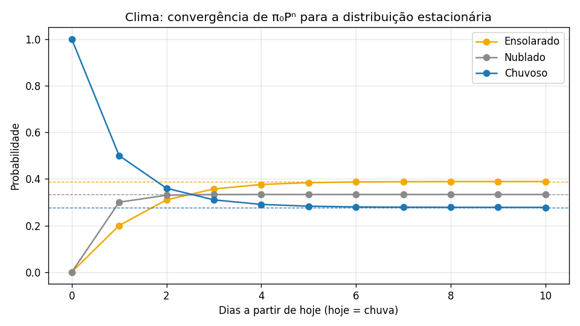
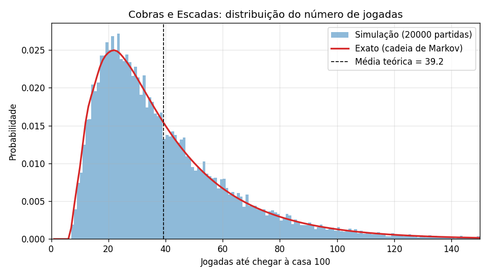

# Cadeias de Markov na Prática

Trabalho prático da disciplina de LFA: resolução de dois problemas com **Cadeias de Markov**, implementados em Python. Os resultados teóricos são verificados por simulação.

| Problema | Tipo de cadeia | Pergunta respondida |
| --- | --- | --- |
| Previsão do clima | Regular | Qual a chance de sol, nuvens ou chuva nos próximos dias, e como fica o clima a longo prazo? |
| Cobras e Escadas | Absorvente | Quantas jogadas, em média, são necessárias para terminar o jogo? |

## Resultados principais

**Previsão do clima**
- A longo prazo, 38,9% dos dias são ensolarados, 33,3% nublados e 27,8% chuvosos (cerca de 101 dias de chuva por ano).
- Qualquer previsão converge para esses valores em 5 a 7 dias, não importa o tempo de hoje.
- Em 10 anos simulados, o erro entre simulação e teoria foi de no máximo 0,0003.

**Cobras e Escadas** (tabuleiro clássico de 100 casas)
- Uma partida dura em média **39,23 jogadas**, calculadas pela matriz fundamental N = (I − Q)⁻¹.
- A mediana é de 32 jogadas e o jogo mais rápido possível leva 7.
- Uma simulação de 20.000 partidas deu média de 39,07 ± 0,35, confirmando o valor exato.





## Como executar

É preciso ter o **Python 3.9 ou superior** instalado.

### macOS / Linux

```bash
python3 -m venv .venv
source .venv/bin/activate
pip install numpy matplotlib
python src/markov_trabalho.py
```

### Windows

```bash
python -m venv .venv
.venv\Scripts\activate
pip install numpy matplotlib
python src/markov_trabalho.py
```

Rode os comandos a partir da pasta raiz do projeto. Os resultados são impressos no terminal e também salvos em `docs/saida_execucao.txt`, e os dois gráficos são salvos em `graphics/`. As pastas são criadas automaticamente se não existirem. A semente aleatória é fixa (42), então cada execução reproduz exatamente os mesmos números.

Nas próximas vezes, basta ativar o ambiente (`source .venv/bin/activate` ou `.venv\Scripts\activate`) e rodar `python src/markov_trabalho.py`.

## Estrutura do projeto

```
├── src/
│   └── markov_trabalho.py                  # código-fonte completo
├── graphics/
│   ├── grafico_clima_convergencia.png      # gráfico do Problema 1
│   └── grafico_cobras_escadas.png          # gráfico do Problema 2
├── docs/
│   ├── saida_execucao.txt                  # resultados da última execução
│   └── Trabalho_Cadeias_de_Markov_ABNT.docx  # relatório no padrão ABNT
├── .gitignore
└── README.md
```

## Como o código está organizado

As funções genéricas servem para qualquer Cadeia de Markov. Para aplicá-las a outro problema, basta trocar a matriz de transição.

| Função | O que faz |
| --- | --- |
| `validar_matriz` | Confere se a matriz é quadrada, não negativa e com linhas somando 1 |
| `distribuicao_n_passos` | Calcula π₀Pⁿ (equação de Chapman-Kolmogorov) |
| `distribuicao_estacionaria` | Resolve πP = π pelo autovetor do autovalor 1 |
| `simular_cadeia` | Gera uma trajetória sorteando cada próximo estado |
| `estimar_matriz` | Estima a matriz de transição a partir de dados observados |
| `montar_matriz_tabuleiro` | Monta a matriz 101 × 101 do Cobras e Escadas |
| `jogar_uma_partida` | Simula uma partida completa (Monte Carlo) |

## Tecnologias

- Python 3
- [NumPy](https://numpy.org/) para álgebra linear
- [Matplotlib](https://matplotlib.org/) para os gráficos

## Referências

- GRINSTEAD, C. M.; SNELL, J. L. *Introduction to Probability*. 2. ed. American Mathematical Society, 1997.
- NORRIS, J. R. *Markov Chains*. Cambridge University Press, 1997.
- ROSS, S. M. *Introduction to Probability Models*. 12. ed. Academic Press, 2019.
- ALTHOEN, S. C.; KING, L.; SCHILLING, K. How long is a game of Snakes and Ladders? *The Mathematical Gazette*, v. 77, n. 478, p. 71-76, 1993.

## Autores

- Fernando Giardini
- Lara Gonçalves
- Maria Luiza Dornelas
